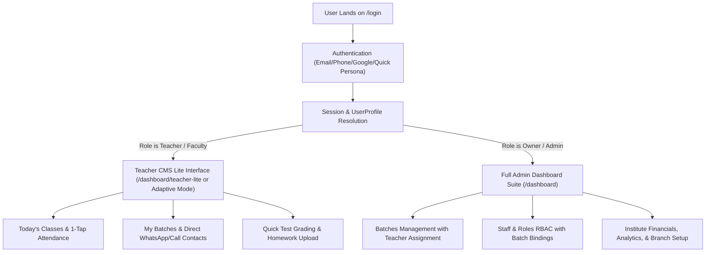

# Specification: Teacher CMS Lite & Admin RBAC System

**Date:** 2026-09-28  
**Status:** Approved  
**Scope:** Authentication UI/UX, Admin Batch & Role-Based Access Control, and Phone-Optimized Teacher CMS Lite  

---

## 1. Executive Summary

Alogyan Teachers CMS is a management platform for private tutors, coaching centers, and educational institutes. This specification outlines:
1. **Clean & Professional Login UI/UX**: High-converting, modern, distraction-free authentication card with email and phone OTP tabs, plus 1-click test persona switchers for Admin and Teacher roles.
2. **Admin Batch Management & RBAC System**: Comprehensive batch administration with assigned faculty, scheduling, fee structure, and fine-grained role-based access control (`owner`, `branch_admin`, `teacher`, `receptionist`, `accountant`) with batch-specific scoping (`assignedBatchIds`).
3. **Teacher CMS Lite (Mobile/Phone-First Experience)**: A lightweight, thumb-friendly mobile interface for teachers with today's class schedule, 1-tap attendance marking, student roster with direct phone/WhatsApp links, and fast academic actions (test marks & homework sharing).

---

## 2. Architecture & Role-Aware Routing

### Role-Based Access Levels
1. **`owner` (Institute Director / Super Admin)**:
   - Full access across all branches, fee collection, financials, staff RBAC, and system settings.
2. **`branch_admin` (Center Manager)**:
   - Manages branch students, admissions, batches, attendance audits, and staff assignments within assigned branches.
3. **`teacher` (Faculty / Tutor)**:
   - Automatically sees **Teacher CMS Lite**.
   - Restricted to batches listed in `assignedBatchIds`.
   - Access to: View assigned batches, mark/edit attendance for own batches, grade tests, upload notes/homework, and communicate with enrolled students/parents.
4. **`receptionist` & `accountant`**:
   - Receptionist: Student check-in, admissions, fee collection.
   - Accountant: Cash receipts, reconciliation, fee invoices.

---

## 3. Detailed Component & UX Design

### 3.1 Clean, Professional Login (`app/(auth)/login/page.tsx`)
* **Layout**:
  * Desktop: Modern split-view with dark-toned branded marketing panel on the left and clean centered card on the right.
  * Mobile: Seamless single-column view with Alogyan emblem and welcoming typography.
* **Authentication Controls**:
  * Tab 1: **Email & Password** with clean validation, floating labels, and password visibility toggle.
  * Tab 2: **Phone OTP** with country prefix selector (+91 default), 10-digit input, and auto-focused 6-digit OTP code cells.
  * Tab 3: **Social Sign In** with official Google button.
* **Quick Persona Test Controls**:
  * Dedicated "Quick Test Access" bar with 2 preset personas:
    * 🛡️ **"Sign in as Admin"**: Authenticates as Director/Owner with full permissions.
    * 👨‍🏫 **"Sign in as Teacher (Lite)"**: Authenticates as Faculty member with assigned demo batches and launches Teacher Lite layout.

### 3.2 Admin Batch Management (`app/(dashboard)/batches/`)
* **Teacher Assignment in Batches**:
  * Batch model extended/ensured with `assignedTeacherId: string` and `teacherName: string`.
  * In the Batch creation/edit dialog, an Admin selects the teacher from active faculty users.
* **Schedule & Delivery Configuration**:
  * Multi-slot schedule builder: Select days (Mon-Sun), start time, duration, and room number.
  * Delivery mode: Offline, Online (with Google Meet link), or Hybrid.
* **Student Roster & Capacity**:
  * Student enrollment count vs capacity indicator (e.g. `24 / 30 Students`).
  * Quick batch actions: Edit, Reassign Faculty, Add Student, Archive.

### 3.3 Admin Staff & Roles RBAC (`app/(dashboard)/settings/staff/`)
* **Staff Member Directory**:
  * Displays active staff members with photo, name, email, phone, role badge, and assigned batches count.
* **Create/Edit Staff Modal**:
  * Role selection: `owner`, `branch_admin`, `teacher`, `receptionist`, `accountant`.
  * Branch assignment selector (or all branches `*`).
  * **Assigned Batches Selector**: When `role === 'teacher'`, displays a multi-select checklist of active batches for this branch. The selected batch IDs are saved to `assignedBatchIds`.

### 3.4 Teacher CMS Lite (Mobile/Phone Experience)
* **Mobile Responsive Container & Bottom Navigation**:
  * Fixed bottom navigation bar optimized for thumb reach:
    1. 📅 **Today** (`/dashboard/teacher-lite` or default tab): Today's active classes, countdown timer to next session, and quick action cards.
    2. 👥 **Batches**: Cards for each assigned batch showing student count, subject, schedule, and room.
    3. 📝 **Attendance**: Fast 1-tap attendance sheet.
    4. 📚 **Academic**: Quick test grading and homework/notes upload.
    5. 👤 **Profile**: Teacher details, switch view, and sign out.
* **1-Tap Attendance Sheet**:
  * Top bar: Batch selector dropdown + Date picker (default today).
  * Quick action: **"Mark All Present"** for 1-tap efficiency.
  * Student rows with high-contrast touch pills:
    * 🟢 **Present (P)**
    * 🔴 **Absent (A)**
    * 🟡 **Late (L)**
  * Real-time counter banner: e.g., *"22 Present · 2 Absent · 1 Late"*.
  * **WhatsApp Absent Alert**: 1-click button to launch WhatsApp with a pre-filled absent notification to parents of all absent students.
* **Student Directory & Phone Actions**:
  * Clean cards for students in the batch.
  * Direct action buttons:
    * 📞 **Call**: `tel:${student.phone || student.parentPhone}`
    * 💬 **WhatsApp**: `https://wa.me/${phone}?text=...`

---

## 4. Data Flow & Security Constraints

1. **Firestore Security & RBAC Rules**:
   - Teachers can only read and write attendance, tests, and notes for batches where `request.auth.uid == batch.teacherId` or `batch.id in user.assignedBatchIds`.
   - Only `owner` and `branch_admin` can create, update, or delete batches and modify staff roles.
2. **Offline-First & Fast Response**:
   - Teacher attendance markings update client state immediately with optimistic UI, followed by background synchronization to Firestore.
3. **Preview & Impersonation for Admins**:
   - Admins can preview the Teacher Lite mobile interface directly without logging out, allowing institute directors to verify teacher views.

---

## 5. Verification & Acceptance Criteria

1. **Login Page**:
   - Clean, professional UI rendering properly on desktop and mobile viewports.
   - Email/password and phone tabs work seamlessly.
   - Quick persona buttons log in instantly as Admin or Teacher.
2. **Admin Batches & RBAC**:
   - Admin can assign a teacher to any batch.
   - Admin can edit staff roles and assign batches in `/settings/staff`.
3. **Teacher CMS Lite (Phone/Mobile)**:
   - On mobile viewports or when logged in as a Teacher, the interface renders the Teacher Lite layout.
   - Bottom navigation bar is visible and responsive.
   - 1-tap attendance toggles work smoothly with zero lag.
   - Direct Call and WhatsApp links trigger standard phone handlers.
   - Test grading and notes upload functions smoothly on mobile screen dimensions.
